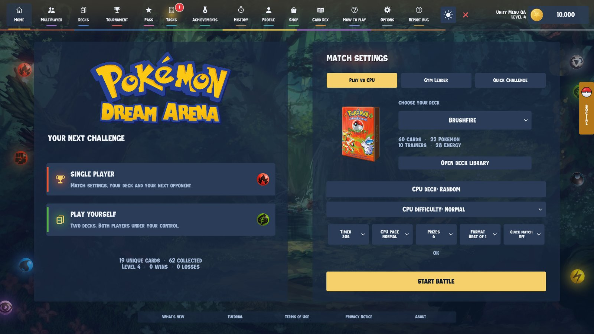
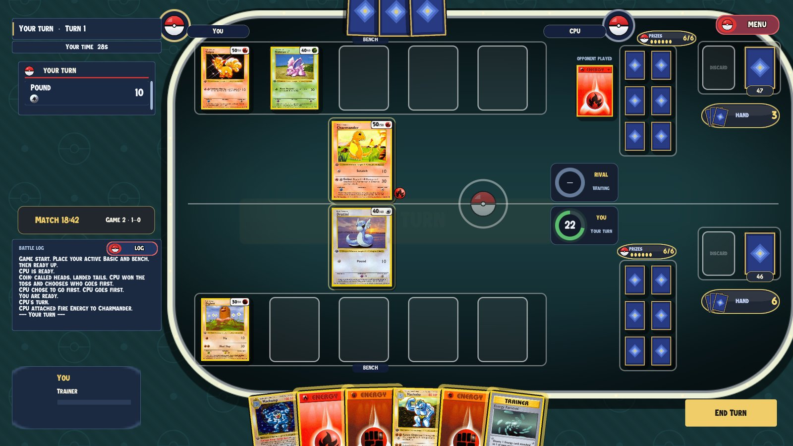
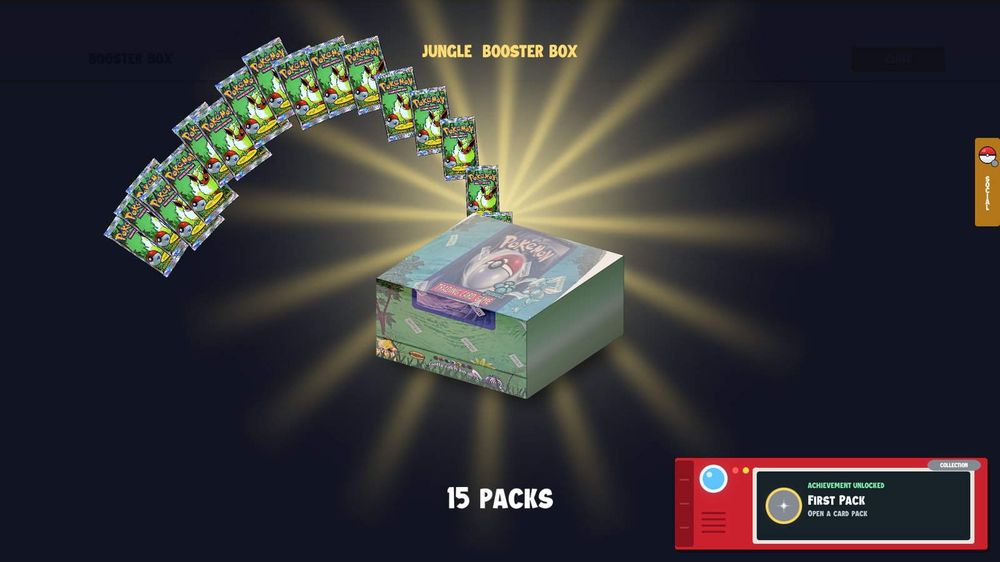
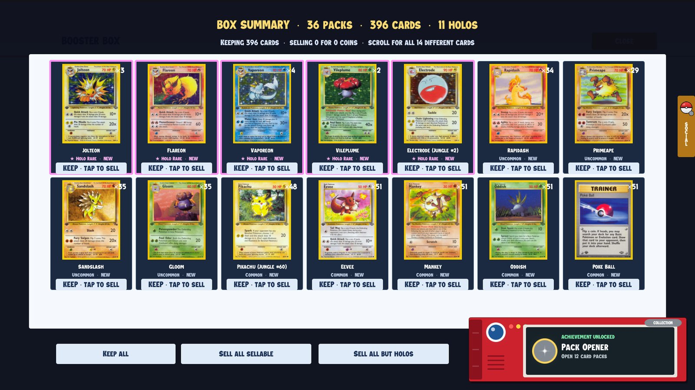
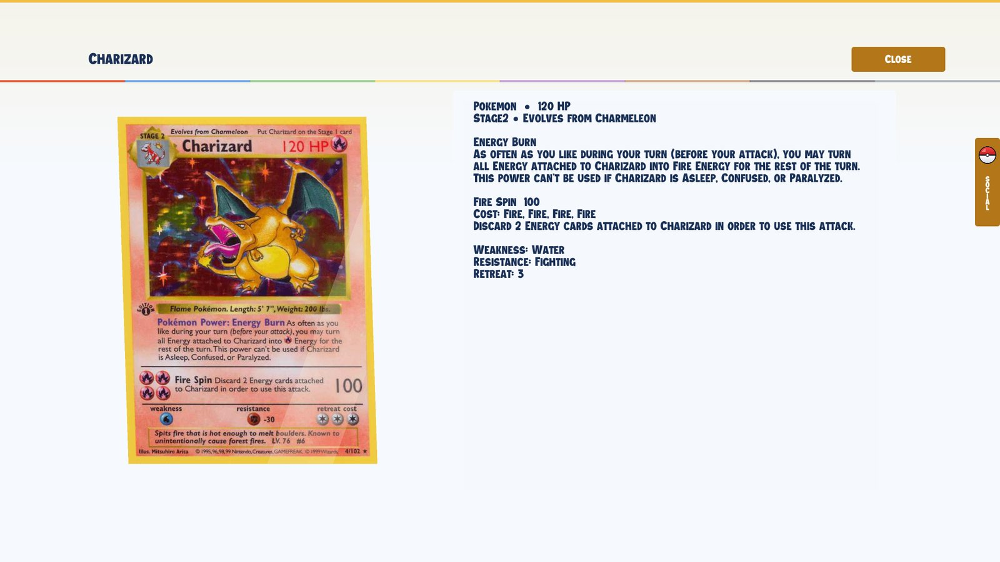
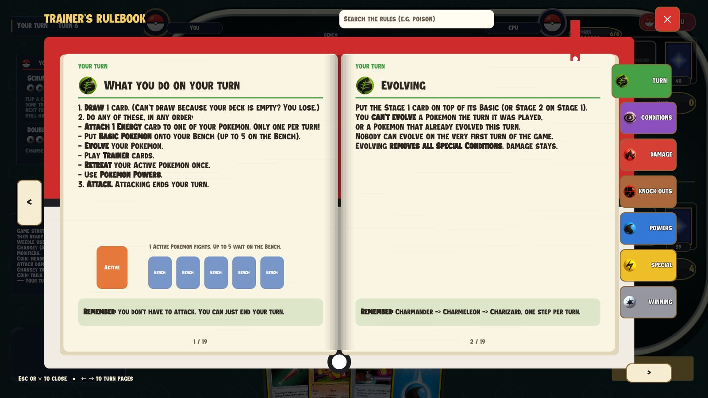
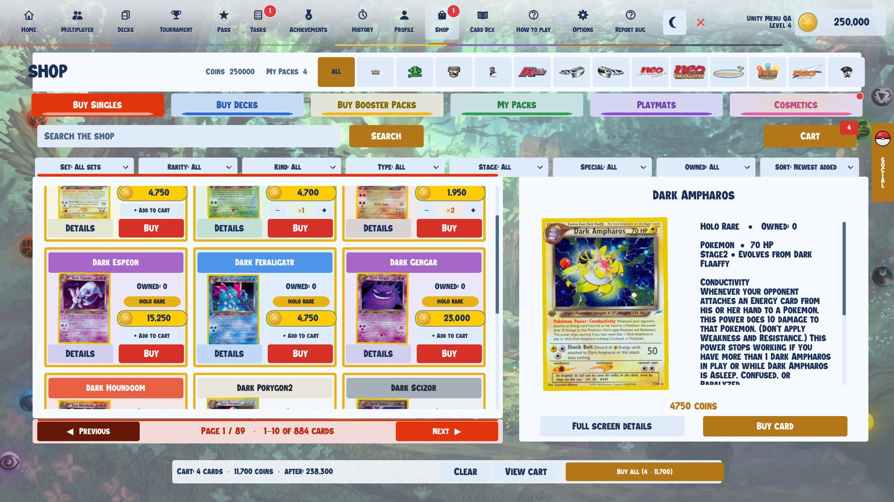
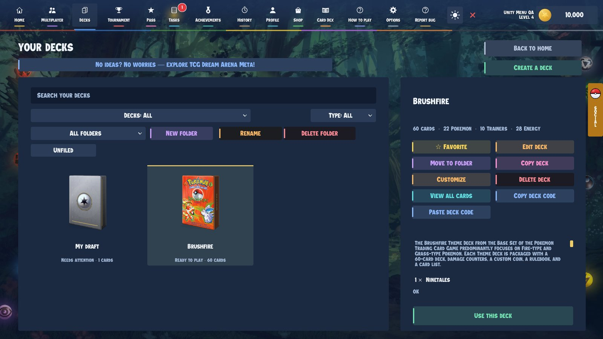

# TCG Dream Arena

**The classic Pokémon Trading Card Game, rebuilt for Windows.**
Classic-era cards from Base Set to Neo, faithful old-school rules, Gym Leaders, booster boxes and an always-on online server. Free and fan-made.

---

## What's new in 2.2.2

- **Trainer's Rulebook**: turn steps, Pokémon Checkup, every Special Condition, damage, Knock Outs and how to win, with chapter tabs and search. Open it from the battle menu, Help or the Home screen.
- Click a **Special Condition** chip on a Pokémon to see what it does.
- Condition reminders now match the real rules (Burned, Confusion damage, retreating while Confused, stacking conditions).
- **Check for updates** button on the Home screen, and **Appear offline** in Social.

[All release notes →](https://github.com/pavlesuto-private/TCG-Dream-Arena-Releases/releases)

## Screenshots

## Features

### Battles and rules accuracy
| | |
|---|---|
| **Classic rules** | Old-school WotC-era rules: Pokémon Powers, Special Conditions, Pokémon Checkup, Trainers and special Energy work as printed. |
| **Single player** | CPU opponents with difficulty levels, Gym Leader challenges and theme decks. |
| **Trainer's Rulebook** | Built-in illustrated rulebook with search; click any condition in battle to read its rule. |
| **Card inspect** | Read any card in full detail in battle or in your collection. |

### Online
| | |
|---|---|
| **Official server** | Always on. No IPs, ports or hosting needed. |
| **Friends and chat** | Friends list, online presence, private chat and Appear offline. |
| **Battle invites** | Invite a friend straight into a match, or open a public room. |
| **Best of 3** | Single games or full Best of 3 matches. |
| **Timers** | Turn and match clocks keep games moving. |
| **Pause and AFK** | Players can pause; inactive opponents are detected. |
| **Spectating** | Watch live matches with reactions and stats. |
| **Reconnect** | Dropped connection? Rejoin your match where you left off. |

### Collection
| | |
|---|---|
| **Booster packs** | Open packs from the classic sets. |
| **Booster boxes** | Open a whole box at once, then keep or sell what you pulled. |
| **Card Dex** | Track every card you own and every card still missing. |
| **Shop and Discount Friday** | Buy singles, packs and boxes, with discounts every Friday. |
| **Decks** | Deck builder with folders and deck boxes. |

### Progress
| | |
|---|---|
| **Dream Pass** | Level up by playing and unlock rewards. |
| **Achievements** | Achievements with titles and badges. |
| **Showcase** | Show off your favourite cards on your public Trainer Card. |
| **Daily login** | Rewards for coming back each day. |

### Extras
| | |
|---|---|
| **Energy Pool** | A mini-game to play between battles. |
| **Cosmetics** | Playmats, sleeves, coins, deck boxes and more. |

Which cards are strongest? See the **[card tier list](https://play.tcgdreamarena.org/meta)**.

## Install and automatic updates

1. **[Download the installer](https://github.com/pavlesuto-private/TCG-Dream-Arena-Releases/releases/latest/download/TCG-Dream-Arena-Setup.exe)** (Windows 10/11, about 724 MB).
2. Run it and choose where to install. A Desktop shortcut is created.
3. Play!

**Updates:** the game tells you when a new version is out, and you can press **Check for updates** on the Home screen at any time. Updates install over the existing game and **your saves are never touched**.

> **Windows SmartScreen** may show "Windows protected your PC" because the installer isn't code-signed. Click **More info → Run anyway**.

## System requirements

| | Minimum |
|---|---|
| OS | Windows 10 or 11, 64-bit |
| Disk | About 1.5 GB free |
| Network | Internet connection for online play and updates |

## FAQ

**Where are my saves?**
In `%APPDATA%\TCGDreamArena` (paste it into the Explorer address bar). Your profile, collection and decks live there, separate from the install folder.

**How do I back up my progress?**
Copy the `%APPDATA%\TCGDreamArena` folder somewhere safe. For cloud backup, link an email address to your account in the game.

**Will updating or reinstalling delete my progress?**
No. The installer never touches your save folder.

**Is it free?**
Yes, completely free.

**I played 1.9.x. What changed?**
2.0.0 moved to a brand-new client with an always-on official server. Just install the latest version.

## Disclaimer

TCG Dream Arena is a free, non-commercial fan project. It is **not affiliated with, endorsed by or sponsored by** Nintendo, Creatures Inc., GAME FREAK inc. or The Pokémon Company.
Pokémon and all related names and artwork are © Nintendo / Creatures Inc. / GAME FREAK inc. / The Pokémon Company.
